# Watchdog Historical Investigation Schema and API Plan

**Status:** Draft for schema review. This document complements [ADR 0001](adr/0001-durable-historical-investigation-storage.md); it does not replace or revise the ADR.

**Implementation:** the schema below is created by [`internal/db/migrations/00001_create_investigation_schema.sql`](../internal/db/migrations/00001_create_investigation_schema.sql), a `goose` migration that Watchdog applies at startup when `DATABASE_URL` is set. Typed queries are generated by `sqlc` into `internal/db/dbgen`. A change to the schema needs a new migration file and the matching change to this document.

This document uses specific names for the different source records: a **static GTFS version**, an **OBA metrics response**, and a **vehicle-position response**. A content hash identifies bytes; it is not a way to retrieve those bytes. The tables below retain the investigation facts needed to interpret an event.

## Entity relationship diagram

```mermaid
erDiagram
    ONEBUSAWAY_SERVER {
        bigint server_id PK
        text normalized_base_url UK
        text display_name
    }
    AGENCY {
        bigint agency_id PK
        bigint server_id FK
        text external_agency_id
        text current_name
    }
    VEHICLE_POSITION_ENDPOINT {
        bigint endpoint_id PK
        bigint server_id FK
        text normalized_vehicle_position_url
    }
    VEHICLE_ENTITY {
        bigint vehicle_entity_id PK
        bigint endpoint_id FK
        text external_vehicle_id
    }
    STATIC_GTFS_SOURCE {
        bigint source_id PK
        bigint server_id FK
        text normalized_source_url
    }
    GTFS_STATIC_VERSION {
        bigint gtfs_static_version_id PK
        bigint server_id FK
        timestamptz published_at
        text combined_content_sha256
    }
    GTFS_STATIC_VERSION_SOURCE {
        bigint gtfs_static_version_id PK, FK
        bigint source_id PK, FK
        text source_content_sha256
    }
    GTFS_STATIC_VERSION_AGENCY {
        bigint gtfs_static_version_id PK, FK
        bigint agency_id PK, FK
    }
    REPORTED_STOP {
        bigint reported_stop_id PK
        bigint agency_id FK
        text oba_stop_id
    }
    REPORTED_TRIP {
        bigint reported_trip_id PK
        bigint agency_id FK
        text oba_trip_id
    }
    TRIP_METADATA_VERSION {
        bigint trip_metadata_version_id PK
        bigint gtfs_static_version_id FK
        bigint agency_id FK
        bigint reported_trip_id FK
        boolean static_trip_found
        text route_id
        text service_id
        text block_id
    }
    STOP_METADATA_VERSION {
        bigint stop_metadata_version_id PK
        bigint gtfs_static_version_id FK
        bigint agency_id FK
        bigint reported_stop_id FK
        boolean static_stop_found
        text stop_name
        double latitude
        double longitude
        text parent_station_id
    }
    UNMATCHED_STOP_EPISODE {
        bigint unmatched_stop_episode_id PK
        bigint agency_id FK
        bigint reported_stop_id FK
        bigint first_response_agency_id FK
        bigint closing_response_agency_id FK
        timestamptz last_reported_at
        text close_reason
    }
    UNMATCHED_STOP_EPISODE_METADATA {
        bigint unmatched_stop_episode_id PK, FK
        bigint stop_metadata_version_id PK, FK
    }
    UNMATCHED_TRIP_EPISODE {
        bigint unmatched_trip_episode_id PK
        bigint agency_id FK
        bigint reported_trip_id FK
        bigint first_response_agency_id FK
        bigint closing_response_agency_id FK
        timestamptz last_reported_at
        text close_reason
    }
    UNMATCHED_TRIP_EPISODE_METADATA {
        bigint unmatched_trip_episode_id PK, FK
        bigint trip_metadata_version_id PK, FK
    }
    OBA_METRICS_RESPONSE {
        bigint response_id PK
        bigint server_id FK
        timestamptz observed_at
        timestamptz upstream_current_time
        integer api_version
    }
    OBA_METRICS_RESPONSE_AGENCY {
        bigint response_agency_id PK
        bigint response_id FK
        bigint agency_id FK
        boolean response_complete
        integer unmatched_stop_count
        integer unmatched_trip_count
        integer matched_stop_count
        integer matched_trip_count
    }
    VEHICLE_POSITION_RESPONSE {
        bigint vehicle_position_response_id PK
        bigint endpoint_id FK
        timestamptz observed_at
        timestamptz source_header_time
        text incrementality
        text payload_sha256
    }
    VEHICLE_POSITION_EVIDENCE {
        bigint vehicle_position_evidence_id PK
        bigint vehicle_position_response_id FK
        bigint vehicle_entity_id FK
        bigint agency_id FK
        text feed_entity_id
        timestamptz vehicle_source_time
        double latitude
        double longitude
        boolean position_valid
        text position_validation_reason
        double reported_speed_mps
        double computed_speed_mps
        double speed_discrepancy_ratio
        text trip_id
        date trip_start_date
        integer trip_start_time_seconds
        smallint current_status
        text expected_schedule_state
        text expected_schedule_reason
        timestamptz expected_window_start
        timestamptz expected_window_end
        bigint gtfs_static_version_id FK
        bigint bounding_box_version_id FK
    }
    VEHICLE_ANOMALY_TYPE {
        smallint anomaly_type_id PK
        text anomaly_code UK
    }
    VEHICLE_ANOMALY_RULE_VERSION {
        bigint rule_version_id PK
        smallint anomaly_type_id FK
        integer rule_logic_version
        text version_name
        text watchdog_build_version
        timestamptz effective_at
        integer stale_age_threshold_seconds
        double reported_speed_threshold_mps
    }
    VEHICLE_ANOMALY_EPISODE {
        bigint vehicle_anomaly_episode_id PK
        bigint vehicle_entity_id FK
        smallint anomaly_type_id FK
        bigint rule_version_id FK
        bigint opening_response_id FK
        bigint closing_response_id FK
        text close_reason
    }
    VEHICLE_ANOMALY_EPISODE_EVIDENCE {
        bigint vehicle_anomaly_episode_id PK, FK
        bigint vehicle_position_evidence_id PK, FK
        text evidence_role PK
    }
    BOUNDING_BOX_VERSION {
        bigint bounding_box_version_id PK
        bigint gtfs_static_version_id FK
        bigint server_id FK
        bigint agency_id FK
        double minimum_latitude
        double maximum_latitude
        double minimum_longitude
        double maximum_longitude
    }
    CLUSTER_SCHEME {
        text scheme_version PK
        smallint s2_level
        text station_grouping
        text description
    }
    S2_CELL {
        text scheme_version PK, FK
        text cell_id PK
        smallint cell_level
        double center_latitude
        double center_longitude
    }
    STOP_CLUSTER_ASSIGNMENT {
        bigint stop_metadata_version_id PK, FK
        text scheme_version PK, FK
        text cell_id PK, FK
        text root_station_id
        text root_station_name
    }

    ONEBUSAWAY_SERVER ||--o{ AGENCY : serves
    ONEBUSAWAY_SERVER ||--o{ VEHICLE_POSITION_ENDPOINT : configures
    VEHICLE_POSITION_ENDPOINT ||--o{ VEHICLE_ENTITY : scopes
    ONEBUSAWAY_SERVER ||--o{ STATIC_GTFS_SOURCE : configures
    ONEBUSAWAY_SERVER ||--o{ GTFS_STATIC_VERSION : publishes
    GTFS_STATIC_VERSION ||--o{ GTFS_STATIC_VERSION_SOURCE : contains
    STATIC_GTFS_SOURCE ||--o{ GTFS_STATIC_VERSION_SOURCE : contributes
    GTFS_STATIC_VERSION ||--o{ GTFS_STATIC_VERSION_AGENCY : covers
    AGENCY ||--o{ GTFS_STATIC_VERSION_AGENCY : belongs_to
    AGENCY ||--o{ REPORTED_STOP : reports
    AGENCY ||--o{ REPORTED_TRIP : reports
    GTFS_STATIC_VERSION ||--o{ STOP_METADATA_VERSION : describes
    REPORTED_STOP ||--o{ STOP_METADATA_VERSION : has_static_context
    GTFS_STATIC_VERSION ||--o{ TRIP_METADATA_VERSION : describes
    REPORTED_TRIP ||--o{ TRIP_METADATA_VERSION : has_static_context
    UNMATCHED_STOP_EPISODE ||--o{ UNMATCHED_STOP_EPISODE_METADATA : retains
    STOP_METADATA_VERSION ||--o{ UNMATCHED_STOP_EPISODE_METADATA : contextualizes
    REPORTED_STOP ||--o{ UNMATCHED_STOP_EPISODE : has
    REPORTED_TRIP ||--o{ UNMATCHED_TRIP_EPISODE : has
    UNMATCHED_TRIP_EPISODE ||--o{ UNMATCHED_TRIP_EPISODE_METADATA : retains
    TRIP_METADATA_VERSION ||--o{ UNMATCHED_TRIP_EPISODE_METADATA : contextualizes
    OBA_METRICS_RESPONSE ||--o{ OBA_METRICS_RESPONSE_AGENCY : covers
    AGENCY ||--o{ OBA_METRICS_RESPONSE_AGENCY : reported_in
    OBA_METRICS_RESPONSE_AGENCY ||--o{ UNMATCHED_STOP_EPISODE : opens_or_closes
    OBA_METRICS_RESPONSE_AGENCY ||--o{ UNMATCHED_TRIP_EPISODE : opens_or_closes
    VEHICLE_POSITION_ENDPOINT ||--o{ VEHICLE_POSITION_RESPONSE : serves
    VEHICLE_POSITION_RESPONSE ||--o{ VEHICLE_POSITION_EVIDENCE : contains
    VEHICLE_ENTITY ||--o{ VEHICLE_POSITION_EVIDENCE : identifies
    AGENCY ||--o{ VEHICLE_POSITION_EVIDENCE : attributes
    VEHICLE_ANOMALY_TYPE ||--o{ VEHICLE_ANOMALY_RULE_VERSION : versions
    VEHICLE_ENTITY ||--o{ VEHICLE_ANOMALY_EPISODE : has
    VEHICLE_ANOMALY_TYPE ||--o{ VEHICLE_ANOMALY_EPISODE : classifies
    VEHICLE_ANOMALY_RULE_VERSION ||--o{ VEHICLE_ANOMALY_EPISODE : evaluated_by
    VEHICLE_POSITION_EVIDENCE ||--o{ VEHICLE_ANOMALY_EPISODE_EVIDENCE : linked_to
    VEHICLE_ANOMALY_EPISODE ||--o{ VEHICLE_ANOMALY_EPISODE_EVIDENCE : supported_by
    GTFS_STATIC_VERSION ||--o{ BOUNDING_BOX_VERSION : supplies
    BOUNDING_BOX_VERSION ||--o{ VEHICLE_POSITION_EVIDENCE : checked_against
    GTFS_STATIC_VERSION ||--o{ VEHICLE_POSITION_EVIDENCE : schedule_context
    STOP_METADATA_VERSION ||--o{ STOP_CLUSTER_ASSIGNMENT : assigned_to
    CLUSTER_SCHEME ||--o{ S2_CELL : defines
    S2_CELL ||--o{ STOP_CLUSTER_ASSIGNMENT : contains
    VEHICLE_POSITION_RESPONSE ||--o{ VEHICLE_ANOMALY_EPISODE : opens
    VEHICLE_POSITION_RESPONSE ||--o{ VEHICLE_ANOMALY_EPISODE : closes
```



## Table definitions and constraints

### Shared conventions

- Internal keys are `BIGINT GENERATED ALWAYS AS IDENTITY`, unless a small fixed lookup key is more appropriate.
- External OBA, GTFS, and vehicle IDs are `TEXT`; their spelling and leading zeroes must be preserved.
- All event times are `TIMESTAMPTZ` in UTC. Keep a source timestamp separately from Watchdog's observation time.
- Never store OBA API keys, realtime feed authorization headers, or URL credentials.
- The database stores only anomaly evidence and unmatched episodes—not normal vehicle samples every collection interval.
- `PK` means primary key and `FK` means foreign key. PostgreSQL does not automatically index foreign-key columns; the index list below names the required access paths.
- The Mermaid diagram shows the relationships. The definitions below specify the proposed columns, keys, nullability, and checks.

### Server, agency, vehicle-position endpoint, and vehicle identity

**`onebusaway_server`**

| Column | Type | Rules / meaning |
|---|---|---|
| `server_id` | `BIGINT GENERATED ALWAYS AS IDENTITY` | Primary key. |
| `normalized_base_url` | `TEXT NOT NULL` | OBA base URL with credentials, query secrets, and fragment removed; unique. |
| `display_name` | `TEXT NOT NULL` | Current configured display name. |
| `created_at` | `TIMESTAMPTZ NOT NULL DEFAULT now()` | Row creation time. |

**`agency`**

| Column | Type | Rules / meaning |
|---|---|---|
| `agency_id` | `BIGINT GENERATED ALWAYS AS IDENTITY` | Primary key. |
| `server_id` | `BIGINT NOT NULL` | Foreign key to `onebusaway_server`. |
| `external_agency_id` | `TEXT NOT NULL` | OBA/GTFS agency ID. |
| `current_name` | `TEXT` | Current known agency name. |
| `UNIQUE` |  | `(server_id, external_agency_id)`. Agency IDs are only unique within a server. |

**`vehicle_position_endpoint`**

| Column | Type | Rules / meaning |
|---|---|---|
| `endpoint_id` | `BIGINT GENERATED ALWAYS AS IDENTITY` | Primary key used by vehicle identities and evidence. |
| `server_id` | `BIGINT NOT NULL` | Foreign key to `onebusaway_server`. |
| `normalized_vehicle_position_url` | `TEXT NOT NULL` | Vehicle-position URL with credentials and secret query values removed. |
| `created_at` | `TIMESTAMPTZ NOT NULL DEFAULT now()` | First time this endpoint is recorded. |
| `UNIQUE` |  | `(server_id, normalized_vehicle_position_url)`. |

Do not use the zero-based configuration index as an identity. The same URL on one server maps to the same endpoint row; a changed URL creates a different row. The same rule applies to server base URLs and static source URLs: a changed URL is a new identity with a new ID, and identities are never merged (D11 in [investigation-api.md](investigation-api.md#6-implementation-decisions)). Incidents retain the endpoint row they used. `trip_update_url` is not part of this table because Watchdog currently does not fetch it for vehicle investigation.

**`vehicle_entity`**

| Column | Type | Rules / meaning |
|---|---|---|
| `vehicle_entity_id` | `BIGINT GENERATED ALWAYS AS IDENTITY` | Primary key. |
| `endpoint_id` | `BIGINT NOT NULL` | Foreign key to `vehicle_position_endpoint`. |
| `external_vehicle_id` | `TEXT NOT NULL` | GTFS-Realtime `VehicleDescriptor.id`. |
| `UNIQUE` |  | `(endpoint_id, external_vehicle_id)`. Vehicle IDs are feed-local. |

### Static GTFS sources and retained static context

**`static_gtfs_source`**

| Column | Type | Rules / meaning |
|---|---|---|
| `source_id` | `BIGINT GENERATED ALWAYS AS IDENTITY` | Primary key. |
| `server_id` | `BIGINT NOT NULL` | Foreign key to `onebusaway_server`. |
| `normalized_source_url` | `TEXT NOT NULL` | Static source URL with credentials and secret query values removed. |
| `UNIQUE` |  | `(server_id, normalized_source_url)`. |

**`gtfs_static_version`** records a complete, validated static GTFS publication:

| Column | Type | Rules / meaning |
|---|---|---|
| `gtfs_static_version_id` | `BIGINT GENERATED ALWAYS AS IDENTITY` | Primary key. |
| `server_id` | `BIGINT NOT NULL` | Foreign key to `onebusaway_server`. |
| `published_at` | `TIMESTAMPTZ NOT NULL` | When Watchdog accepted and published this complete static version. |
| `combined_content_sha256` | `CHAR(64)` | Optional SHA-256 fingerprint for comparison and provenance only. |
| `parser_version` | `TEXT` | Watchdog parser/build version when available. |

This identifies the GTFS data Watchdog had loaded. It does not identify the Java or Maglev backend's own static data; the OBA metrics response currently provides no source GTFS hash to prove both sides used identical files.

**`gtfs_static_version_source`** has `gtfs_static_version_id BIGINT NOT NULL`, `source_id BIGINT NOT NULL`, and `source_content_sha256 CHAR(64) NOT NULL`; its primary key is `(gtfs_static_version_id, source_id)`. Both ID columns are foreign keys.

Require each supplied SHA-256 value to contain 64 hexadecimal characters. Hashes are provenance fields, not foreign keys and not retrieval references.

**`gtfs_static_version_agency`** has `gtfs_static_version_id BIGINT NOT NULL` and `agency_id BIGINT NOT NULL`, both foreign keys, with a composite primary key on those columns.

**A hash is not a lookup key for data that was never retained.** These hashes can tell us that two retrieved files had the same or different content. They cannot recover a GTFS archive or tell us the stop times by themselves. This design does not store the complete GTFS archive.

**`reported_stop`** has one row per stop ID that OBA listed as unmatched, per agency. The row exists even if Watchdog's static GTFS does not contain that ID. This table does not look at static GTFS; whether the ID was found there is recorded in `stop_metadata_version.static_stop_found`.

- `reported_stop_id BIGINT GENERATED ALWAYS AS IDENTITY` primary key. An internal row number used only for joins; it has no meaning outside the database.
- `agency_id BIGINT NOT NULL` foreign key: the agency OBA reported the stop under.
- `oba_stop_id TEXT NOT NULL`: the stop ID exactly as it appeared in OBA's metrics.json response.
- Unique `(agency_id, oba_stop_id)`: the same stop ID is stored once per agency. Stop `"123"` in agency A and stop `"123"` in agency B are different rows.
- Unique `(reported_stop_id, agency_id)`: adds no new uniqueness (the primary key is already unique). It lets other tables reference (stop, agency) together, so the database rejects a link between a stop and a different agency.

**`reported_trip`** has one row per trip ID that OBA listed as unmatched (`realtimeTripIDsUnmatched`), per agency. Watchdog does not track trip progress; this identity exists only for unmatched-trip episodes (issue #157). Its columns mirror `reported_stop`: `reported_trip_id BIGINT GENERATED ALWAYS AS IDENTITY` primary key (internal row number), `agency_id BIGINT NOT NULL` foreign key, and `oba_trip_id TEXT NOT NULL` (the trip ID exactly as it appeared in metrics.json), with unique `(agency_id, oba_trip_id)` and `(reported_trip_id, agency_id)` for the same reasons.

**`trip_metadata_version`** stores only the static facts needed to investigate a reported unmatched trip, not a full trip schedule:

- `trip_metadata_version_id BIGINT GENERATED ALWAYS AS IDENTITY` primary key;
- `gtfs_static_version_id BIGINT NOT NULL`, `agency_id BIGINT NOT NULL`, and `reported_trip_id BIGINT NOT NULL`;
- `static_trip_found BOOLEAN NOT NULL`;
- nullable `route_id TEXT`, `service_id TEXT`, and `block_id TEXT` when the trip exists in Watchdog's static GTFS;
- unique `(gtfs_static_version_id, reported_trip_id)` and `(trip_metadata_version_id, reported_trip_id, agency_id)`;
- composite foreign key `(reported_trip_id, agency_id)` to `reported_trip`.

When `static_trip_found` is false, `route_id`, `service_id`, and `block_id` must be null. When true, retain the fields available from that GTFS version.

This describes Watchdog's available static GTFS version; it does not prove that the Java or Maglev backend used the same files internally. The OBA metrics response currently provides no static GTFS content hash to establish that equality.

**`unmatched_trip_episode_metadata`** has `unmatched_trip_episode_id BIGINT NOT NULL`, `trip_metadata_version_id BIGINT NOT NULL`, `reported_trip_id BIGINT NOT NULL`, and `agency_id BIGINT NOT NULL`, with a composite primary key on the episode and metadata version. Composite foreign keys ensure both rows refer to the same `(agency_id, reported_trip_id)`. A trip absent from Watchdog's static GTFS still has its reported ID and episode; its metadata row records `static_trip_found = FALSE`.

**`stop_metadata_version`** stores only context for stops referenced by retained unmatched-stop episodes:

- `stop_metadata_version_id BIGINT GENERATED ALWAYS AS IDENTITY` primary key;
- `gtfs_static_version_id BIGINT NOT NULL` foreign key;
- `agency_id BIGINT NOT NULL` and `reported_stop_id BIGINT NOT NULL`, referencing the same agency-scoped reported-stop identity;
- `static_stop_found BOOLEAN NOT NULL`, indicating whether Watchdog found this stop ID in this static GTFS version;
- nullable `stop_name TEXT`, `latitude DOUBLE PRECISION`, `longitude DOUBLE PRECISION`, `parent_station_id TEXT`, and `location_type SMALLINT`;
- unique `(gtfs_static_version_id, reported_stop_id)` and `(stop_metadata_version_id, reported_stop_id, agency_id)`;
- foreign key `(reported_stop_id, agency_id)` to `reported_stop(reported_stop_id, agency_id)`;
- when `static_stop_found` is false, static stop fields must be null; when true, latitude/longitude must either both be null or both be present and within WGS-84 ranges, and `location_type` must be null or between 0 and 5.

Watchdog looks the stop ID up in the static GTFS version it has loaded for that server and records the result **even if the stop ID was not found**. A "not found" row (`static_stop_found = FALSE`, all other fields null) is evidence in its own right: "we looked in version 12 and this stop was not there." If Watchdog has no static version loaded yet (for example, right after startup), no row is written until one is published. See [When metadata rows are written](#when-metadata-rows-are-written) for the exact triggers.

**`unmatched_stop_episode_metadata`** has `unmatched_stop_episode_id BIGINT NOT NULL`, `stop_metadata_version_id BIGINT NOT NULL`, `reported_stop_id BIGINT NOT NULL`, and `agency_id BIGINT NOT NULL`. Its primary key is `(unmatched_stop_episode_id, stop_metadata_version_id)`. Add unique keys `(unmatched_stop_episode_id, reported_stop_id, agency_id)` to the episode table and `(stop_metadata_version_id, reported_stop_id, agency_id)` to the metadata table. Composite foreign keys from the association row to those keys ensure both sides refer to the same `(agency_id, reported_stop_id)`. One episode can link to several metadata rows if Watchdog's static facts for the stop changed while it was open.

#### When metadata rows are written

These rules apply to stops and trips alike (`stop_metadata_version` / `unmatched_stop_episode_metadata` and `trip_metadata_version` / `unmatched_trip_episode_metadata`). "Static facts" means every column after the IDs: for stops, `static_stop_found`, `stop_name`, `latitude`, `longitude`, `parent_station_id`, `location_type`; for trips, `static_trip_found`, `route_id`, `service_id`, `block_id`.

**1. When an episode opens.** If Watchdog has a static version loaded for the server, look the ID up in it.
- If the newest existing metadata row for this reported stop/trip has the same static facts, link the episode to that row.
- Otherwise, insert a metadata row for the loaded version and link the episode to it.
- If no static version is loaded, link nothing yet; trigger 2 adds the first link.

**2. When Watchdog publishes a new static version.** For each **open** episode on that server, look the ID up in the new version and compare with the episode's newest linked row.
- If the static facts are unchanged, do nothing. No duplicate row is written.
- If they changed (including found ↔ not found), insert a metadata row for the new version and link the episode to it.

**3. Never on ordinary polls.** Repeated OBA reports update only `last_reported_at`; they do not write metadata rows.

**Which row applied when.** Order an episode's linked rows by their version's `published_at`. Each row applies from that time (or from the episode's opening, if later) until the next linked row. The version on a linked row can be older than the version Watchdog had loaded at a given moment; that means the facts did not change between them.

**Decision: a Watchdog static refresh never changes an episode's state.** A new static version adds metadata rows (trigger 2 above) but does not open, close, or split an unmatched episode. Only OBA metrics responses do that.

Reasons:

1. **The refresh is Watchdog's GTFS, not OBA's.** An episode records what OBA reported. Watchdog and the OBA backend load GTFS on separate schedules, and the OBA metrics response includes no GTFS version or hash. A Watchdog refresh therefore says nothing about which data OBA is using.
2. **Acting on it would create false closes and splits.** Example: stop X is unmatched; a new GTFS adds X; Watchdog loads it at 03:00 but OBA reloads at 05:00. Closing at 03:00 would be followed by OBA reporting X again at 03:00:30, opening a new episode. One continuous report would appear as two.
3. **"Found in GTFS" is not "matched" for Java OBA.** Java reports a stop unmatched when it fails to match a specific trip, so a stop can exist in GTFS and still be reported unmatched. Closing on "now found" would be wrong there.
4. **The authoritative signal arrives on the next poll.** If the new GTFS really fixes the problem, OBA stops reporting the ID on its next response and the episode closes as `not_reported`. The refresh adds no information about whether the report ended.

What the refresh does provide is context. The new metadata row records what changed and when (for example, "not found in version 12, found in version 13 from 03:00"). The investigation API can show this as a hint, such as "found in Watchdog's static version 13 since 03:00, still reported unmatched by OBA", which points to an OBA reload delay or a Java trip-matching issue. It never decides the episode's state.

**Revisit when** the OBA metrics response exposes the GTFS version or content hash the backend actually loaded. Watchdog could then record OBA-side static changes, and an OBA-side change could become a valid reason to close or split an episode.

**Watchdog's GTFS can differ from OBA's.** A stop can be *found* in Watchdog's newer version while OBA, which may not have reloaded yet, still reports it as unmatched. The data allows this; the investigation view must present it as "found in Watchdog's static version N", not as "matched".

**`bounding_box_version`** stores the actual bounds used for a check, not just a reference or hash:

- `bounding_box_version_id BIGINT GENERATED ALWAYS AS IDENTITY` primary key;
- `gtfs_static_version_id BIGINT NOT NULL` and `server_id BIGINT NOT NULL` foreign keys;
- `agency_id BIGINT` foreign key; null means the server-wide union box;
- four `DOUBLE PRECISION NOT NULL` columns: `minimum_latitude`, `maximum_latitude`, `minimum_longitude`, and `maximum_longitude`;
- checks for WGS-84 coordinate ranges and minimums not greater than maximums;
- one server-wide box per static GTFS version and one box per agency per static GTFS version, enforced with partial unique indexes.

**`cluster_scheme`** defines the rules used to group stops into clusters. Today the only scheme is: the S2 cell at level 13 that contains the stop's own coordinates, plus the root station of the stop's GTFS parent hierarchy (or no station).

- `scheme_version TEXT` primary key: a readable label, e.g. `s2_l13_root_station_v1`;
- `s2_level SMALLINT NOT NULL`, checked `BETWEEN 0 AND 30`: the S2 level stops are bucketed at;
- `station_grouping TEXT NOT NULL`: how the station is chosen, e.g. `root_parent_station`;
- `description TEXT NOT NULL`: plain-language description of the rules;
- `created_at TIMESTAMPTZ NOT NULL DEFAULT now()`: when Watchdog first used this scheme;
- unique `(scheme_version, s2_level)`, the target that keeps `s2_cell.cell_level` consistent with its scheme.

The scheme is defined in Watchdog code, not edited in the database. Watchdog inserts its current scheme at startup if the row does not exist. Any change to the S2 level or the station-grouping rule requires a new `scheme_version` label. Existing assignments keep their old label, so historical cluster counts are never mixed across schemes.

**`s2_cell`** has `scheme_version TEXT NOT NULL`, `cell_id TEXT NOT NULL`, `cell_level SMALLINT NOT NULL`, `center_latitude DOUBLE PRECISION NOT NULL`, and `center_longitude DOUBLE PRECISION NOT NULL`. Its composite primary key is `(scheme_version, cell_id)`. A composite foreign key `(scheme_version, cell_level)` references `cluster_scheme (scheme_version, s2_level)`, so a cell's level must equal its scheme's level. Check center coordinates against WGS-84 ranges.

**`stop_cluster_assignment`** has `stop_metadata_version_id BIGINT NOT NULL`, `scheme_version TEXT NOT NULL`, `cell_id TEXT NOT NULL`, `root_station_id TEXT` and `root_station_name TEXT`. The root station is the top of the stop's `parent_station` chain in Watchdog's static GTFS. It is stored as values rather than a reference, because a station is usually not a reported stop and so has no `stop_metadata_version` row (D20 in [investigation-api.md](investigation-api.md#6-implementation-decisions)). Both are null when the stop has no station, and a name requires an ID. The primary key is `(stop_metadata_version_id, scheme_version)`. `stop_metadata_version_id` references `stop_metadata_version`; `(scheme_version, cell_id)` references `s2_cell`. The clustering rules live in `cluster_scheme`, so this table has no separate algorithm-version column. Cluster counts are derived from unmatched-stop episodes and are not inserted every poll.

### OBA metrics responses and unmatched episodes

**`onebusaway_metrics_response`** records a successful observation used to open or close an episode; it does not store the full JSON body:

- `response_id BIGINT GENERATED ALWAYS AS IDENTITY` primary key;
- `server_id BIGINT NOT NULL` foreign key;
- `observed_at TIMESTAMPTZ NOT NULL` and optional `upstream_current_time TIMESTAMPTZ`;
- optional `api_version INTEGER`.

Watchdog treats Java OBA and Maglev as one system and does not record which implementation produced a response (D13 in [investigation-api.md](investigation-api.md#6-implementation-decisions)).

**`onebusaway_metrics_response_agency`** has:

- `response_agency_id BIGINT GENERATED ALWAYS AS IDENTITY` primary key;
- `response_id BIGINT NOT NULL` and `agency_id BIGINT NOT NULL` foreign keys;
- `response_complete BOOLEAN NOT NULL`;
- nullable reported counts: `unmatched_stop_count`, `unmatched_trip_count`, `matched_stop_count`, and `matched_trip_count` as `INTEGER`;
- unique `(response_id, agency_id)` and `(response_agency_id, agency_id)`; the second key supports agency-scoped foreign keys from episodes.

Each count remains null when absent from the response; when present, it must be non-negative.

`response_complete = TRUE` means the HTTP request and JSON decoding succeeded and the agency was included in `agencyIDs`. Only such a row can close an unmatched episode. Counts are null when the field is absent and non-negative when present.

Create an agency row for each monitored agency evaluated against a successful OBA response. Set `response_complete = FALSE` if the agency is absent or the response is incomplete; such a row must not open or close an episode. A failed HTTP request creates no successful response row and cannot close an episode.

**`unmatched_stop_episode`** has:

- `unmatched_stop_episode_id BIGINT GENERATED ALWAYS AS IDENTITY` primary key;
- `reported_stop_id BIGINT NOT NULL` and `agency_id BIGINT NOT NULL`;
- `first_response_agency_id BIGINT NOT NULL` and nullable `closing_response_agency_id BIGINT`;
- `last_reported_at TIMESTAMPTZ NOT NULL`, initialized from the first response and updated when a later complete response still reports the ID;
- nullable `close_reason TEXT`, null while open and `not_reported` when closed. `close_reason` currently has only one possible value for unmatched episodes, `not_reported`, so today it carries no information beyond `closing_response_agency_id IS NOT NULL`. It is kept on purpose so later close reasons (for example, an agency removed from monitoring) can be added without a schema change. Check it against an allowed list (`CHECK (close_reason IN ('not_reported'))`) and extend that list when a new reason is approved.
- unique `(unmatched_stop_episode_id, reported_stop_id, agency_id)` for the metadata association table.

**`unmatched_trip_episode`** has the equivalent fields using `reported_trip_id` instead of `reported_stop_id` and has unique `(unmatched_trip_episode_id, reported_trip_id, agency_id)`.

For each episode table, add composite foreign keys from `(reported_stop_id, agency_id)` or `(reported_trip_id, agency_id)` to the corresponding reported-entity table. Add composite foreign keys from `(first_response_agency_id, agency_id)` and `(closing_response_agency_id, agency_id)` to `onebusaway_metrics_response_agency(response_agency_id, agency_id)`. These prevent an episode for one agency from being opened or closed by another agency's response.

The opening time is obtained from the referenced first response's `observed_at`. The ending time is obtained from the closing response's `observed_at`; the episode does not claim the exact time the backend changed its classification.

Require `close_reason IS NULL` exactly when `closing_response_agency_id IS NULL`. The opening and closing responses must have `response_complete = TRUE`; a trigger enforces this, since a `CHECK` cannot read another table. An episode is open while its closing response is null. A partial unique index permits at most one open episode per reported stop or trip. If the ID appears again after closure, create a new episode. This represents a period during which OBA reported the ID as unmatched; it does not assert why the ID later disappeared. Repeated reports update the one open episode's `last_reported_at`; they do not insert a new episode or a full response body every poll.

### Vehicle-position responses and anomaly evidence

**`vehicle_position_response`** stores the response metadata only when needed to support episode evidence:

- `vehicle_position_response_id BIGINT GENERATED ALWAYS AS IDENTITY` primary key;
- `endpoint_id BIGINT NOT NULL` foreign key;
- `observed_at TIMESTAMPTZ NOT NULL` and optional GTFS-Realtime `source_header_time TIMESTAMPTZ`;
- `incrementality TEXT NOT NULL`, checked to `FULL_DATASET` or `DIFFERENTIAL`;
- optional `payload_sha256 CHAR(64)`, a fingerprint only; it cannot retrieve the response body.

Do not store a row for every ordinary vehicle poll. Insert evidence when an anomaly opens, when it closes, and, while it is open, when the vehicle's `trip_id` or `trip_start_date` differs from the most recently saved evidence row for that episode (`meaningful_change`). Nothing else creates a `meaningful_change` row (D14).

**`vehicle_position_evidence`** stores the actual values needed to investigate an event:

- `vehicle_position_evidence_id BIGINT GENERATED ALWAYS AS IDENTITY` primary key;
- `vehicle_position_response_id BIGINT NOT NULL` foreign key;
- nullable `vehicle_entity_id BIGINT` foreign key when `VehicleDescriptor.id` is present;
- nullable `feed_entity_id TEXT` for the GTFS-Realtime entity ID and nullable `agency_id BIGINT` for agency attribution;
- nullable `attribution_reason TEXT` when the vehicle could not be assigned to an agency, checked to the `gtfs.AttributionFailureReason` values `missing_vehicle_id`, `missing_route_id`, `unknown_route_id`, `agency_not_reported_by_oba`, `ambiguous_identifier`, `route_trip_conflict`;
- nullable `vehicle_source_time TIMESTAMPTZ`, `latitude DOUBLE PRECISION`, and `longitude DOUBLE PRECISION`;
- `position_valid BOOLEAN NOT NULL` and `position_validation_reason TEXT`, which is null exactly when the position is valid and otherwise one of `missing_position`, `non_finite_coordinate`, `placeholder_zero_coordinate`, `latitude_out_of_range`, `longitude_out_of_range` (mirroring `geo.IsValidLatLon`);
- nullable `reported_speed_mps DOUBLE PRECISION`, `computed_speed_mps DOUBLE PRECISION`, `speed_discrepancy_ratio DOUBLE PRECISION`, and `current_status SMALLINT`;
- nullable `trip_id TEXT`, `route_id TEXT`, `trip_start_date DATE`, `trip_start_time_seconds INTEGER` (seconds after local service-day midnight; may exceed 86,400), and `schedule_relationship TEXT` from the realtime descriptor;
- nullable `expected_schedule_state TEXT`, checked to `expected_active`, `expected_inactive`, or `unknown`, and `expected_schedule_reason TEXT`, which is null exactly when the state is null. With `unknown` it is one of `no_trip_descriptor`, `trip_not_in_static_gtfs`, `trip_instance_ambiguous`; with `expected_inactive`, one of `service_not_active_on_date`, `before_scheduled_window`, `after_scheduled_window`; with `expected_active`, `within_scheduled_window` (D15);
- nullable `expected_window_start TIMESTAMPTZ` and `expected_window_end TIMESTAMPTZ` as absolute UTC instants after applying the agency timezone;
- nullable `gtfs_static_version_id BIGINT` and `bounding_box_version_id BIGINT` foreign keys.

Create a partial unique index on `(vehicle_position_response_id, vehicle_entity_id)` when `vehicle_entity_id IS NOT NULL`, so one feed response has at most one evidence row per identified vehicle. Rows with no vehicle ID can retain one-off evidence using `feed_entity_id`, but cannot be grouped into a continuing vehicle episode without a separate identity rule.

Keep raw vehicle coordinates in evidence even when they are invalid; apply WGS-84 range constraints to static stop metadata and bounding-box values, not to the values whose invalidity is being investigated. When no stable vehicle ID exists, evidence can be retained as a single observation, but it cannot form a reliable multi-observation vehicle episode without a separate identity rule.

Watchdog compiles the compact per-trip time-window index in memory at startup and after each successfully published static GTFS version. PostgreSQL does not store every trip's complete schedule in the initial design. The evidence row stores the calculated status, evaluated window, trip descriptor, and static version used. If old results later need recalculation under new rules, add versioned trip-schedule tables; the code TODO is in `internal/gtfs/schedule.go`.

**`vehicle_anomaly_type`** has `anomaly_type_id SMALLINT GENERATED ALWAYS AS IDENTITY` primary key, unique `anomaly_code TEXT`, and `description TEXT NOT NULL`. Seed it with `stale_source_timestamp`, `invalid_coordinate`, and `stopped_out_of_bounds`; add `reported_speed_plausibility` only after approving its threshold.

**`vehicle_anomaly_rule_version`** has:

- `rule_version_id BIGINT GENERATED ALWAYS AS IDENTITY` primary key;
- `anomaly_type_id SMALLINT NOT NULL` foreign key;
- `rule_logic_version INTEGER NOT NULL`, checked `>= 1`: a per-type constant in Watchdog code, bumped by a developer whenever the detection logic changes;
- `version_name TEXT NOT NULL`: a readable label for investigators, e.g. `logic 1, stale > 150s`;
- nullable `watchdog_build_version TEXT`: the Watchdog build that created the row, when available;
- `effective_at TIMESTAMPTZ NOT NULL`: when Watchdog started applying this rule. This is **not** an episode's start time;
- nullable `stale_age_threshold_seconds INTEGER` and nullable `reported_speed_threshold_mps DOUBLE PRECISION`, each non-negative when supplied. The speed threshold remains unset until historical speeds are reviewed;
- `UNIQUE (anomaly_type_id, effective_at)`. `version_name` is not unique, because a rule can return to earlier values later and that is still a new period.

Rule versions come from Watchdog code and configuration; nobody edits them in the database:

1. At startup, for each anomaly type, Watchdog computes its current rule: the `rule_logic_version` constant plus the effective thresholds. For example, the stale threshold is `clamp(5 × collection interval, 60s, 300s)`, so it changes when the collection interval changes.
2. Watchdog compares that with the newest row for the type (highest `effective_at`).
3. If `rule_logic_version` or any threshold differs, or no row exists, it inserts a new row with `effective_at` set to the startup time. Otherwise it reuses the newest row.
4. Each new episode references the row in effect when it opened. An open episode keeps its original rule version even if a later restart creates a new one.

Types with no numeric threshold (`invalid_coordinate`, `stopped_out_of_bounds`) still get a row, with both thresholds null; only `rule_logic_version` distinguishes their versions.

**`vehicle_anomaly_episode`** has `vehicle_anomaly_episode_id BIGINT GENERATED ALWAYS AS IDENTITY` primary key, `vehicle_entity_id BIGINT NOT NULL`, `anomaly_type_id SMALLINT NOT NULL`, `rule_version_id BIGINT NOT NULL`, `opening_response_id BIGINT NOT NULL`, nullable `closing_response_id BIGINT`, and nullable `close_reason TEXT`. All IDs are foreign keys; both response columns reference `vehicle_position_response`. A check requires `closing_response_id` and `close_reason` to either both be null (open) or both be present (closed).

The opening time is the opening response's `observed_at`, and the closing time is the closing response's `observed_at`. This matches the unmatched episodes, which reference their first response directly. The rule version's `effective_at` is not the episode's start.

The opening and closing responses must belong to the vehicle's endpoint, and the closing response must not be observed before the opening one. A trigger enforces both, since plain foreign keys cannot compare rows. The episode's `opening` evidence link must point to evidence from the same `opening_response_id`; write the episode, its opening evidence, and the link in one transaction.

Close reasons are type-specific values such as `fresh_source_timestamp`, `not_present_in_full_dataset`, `coordinates_valid_again`, `inside_bounding_box`, or `no_longer_stopped_at_stop`. They describe the observed closing condition, not a physical root cause.

**`vehicle_anomaly_episode_evidence`** has `vehicle_anomaly_episode_id BIGINT NOT NULL`, `vehicle_position_evidence_id BIGINT NOT NULL`, and `evidence_role TEXT NOT NULL`, checked to `opening`, `meaningful_change`, or `resolution`. The primary key is `(vehicle_anomaly_episode_id, vehicle_position_evidence_id, evidence_role)`. Its ID columns are foreign keys. Add a partial unique index permitting one `opening` link and one `resolution` link per episode; any number of `meaningful_change` links are allowed. Do not duplicate `evidence_role` on the vehicle evidence row.

A partial unique index permits one open episode per `(vehicle_entity_id, anomaly_type_id)`. A vehicle-position response can close an episode because the vehicle became fresh or because it was absent from a complete response. The close reason distinguishes these cases.

### Indexes, retention, and exclusions

At minimum, add indexes for:

- `agency(server_id, external_agency_id)` and endpoint URL uniqueness;
- `vehicle_entity(endpoint_id, external_vehicle_id)` uniqueness;
- `onebusaway_metrics_response(server_id, observed_at DESC)`;
- `onebusaway_metrics_response_agency(agency_id, response_id)`;
- `vehicle_position_response(endpoint_id, observed_at DESC)`;
- `vehicle_position_evidence(vehicle_entity_id, vehicle_position_response_id)` where the vehicle ID is known;
- episode entity foreign keys, episode-to-response references, stop/trip metadata references, and bounding-box/version references.

Use the following access and partial-uniqueness indexes:

```sql
CREATE INDEX onebusaway_metrics_response_server_time
    ON onebusaway_metrics_response (server_id, observed_at DESC);

CREATE INDEX onebusaway_metrics_response_agency_agency_time
    ON onebusaway_metrics_response_agency (agency_id, response_id);

CREATE INDEX vehicle_position_response_endpoint_time
    ON vehicle_position_response (endpoint_id, observed_at DESC);

CREATE INDEX vehicle_position_evidence_vehicle_time
    ON vehicle_position_evidence (vehicle_entity_id, vehicle_position_response_id)
    WHERE vehicle_entity_id IS NOT NULL;

CREATE INDEX unmatched_stop_episode_entity
    ON unmatched_stop_episode (reported_stop_id, first_response_agency_id);

CREATE INDEX unmatched_trip_episode_entity
    ON unmatched_trip_episode (reported_trip_id, first_response_agency_id);

CREATE INDEX vehicle_anomaly_episode_entity_type
    ON vehicle_anomaly_episode (vehicle_entity_id, anomaly_type_id, closing_response_id);

CREATE INDEX vehicle_anomaly_episode_opening
    ON vehicle_anomaly_episode (opening_response_id);

CREATE UNIQUE INDEX unmatched_stop_one_open_per_entity
    ON unmatched_stop_episode (reported_stop_id)
    WHERE closing_response_agency_id IS NULL;

CREATE UNIQUE INDEX unmatched_trip_one_open_per_entity
    ON unmatched_trip_episode (reported_trip_id)
    WHERE closing_response_agency_id IS NULL;

CREATE UNIQUE INDEX vehicle_anomaly_one_open_per_type
    ON vehicle_anomaly_episode (vehicle_entity_id, anomaly_type_id)
    WHERE closing_response_id IS NULL;
```

A retention job runs every 24 hours (D16). It deletes closed episodes and their evidence 90 days after `closed_at`. Open episodes are kept until they close, except for servers no longer in the configuration: their open episodes are deleted 90 days after their last observation (`last_reported_at` for unmatched episodes; the newest evidence's response `observed_at` for vehicle episodes). A removed server's history otherwise stays queryable. Static context, responses and identities are deleted once nothing references them. Do not store raw full-feed payloads or normal per-vehicle samples.

The initial schema does not include separate vehicle-feed-absence records or PostgreSQL-outage records. Vehicle absence is informational and does not prove a vehicle problem; PostgreSQL availability recording and alerting remain deferred.

## Meaning of unmatched reports

An unmatched stop or trip episode means **the named backend included that ID in an unmatched list during the recorded period**. It is not a permanent property of the stop or trip, and closing an episode does not mean that the ID was matched.

The differences between Java OBA and Maglev described below are background for reading reports. They have been reported upstream for alignment, and Watchdog treats both implementations as one system (D13).

- **Java OBA stop classification:** tries to associate a stop-time update with a scheduled stop for that trip using sequence and ID, then falls back to stop ID and scheduled time. A stop can exist in static GTFS but fail the trip-specific match. The internal matched and unmatched stop sets are independent, so one ID can appear in both when different updates classify it differently.
- **Maglev stop classification:** checks whether the stop ID exists anywhere in its static stop list. It does not check trip, sequence, or time.
- **Java OBA trip classification:** includes trips that do not resolve to a static trip, but its unmatched set is also populated for processing cases such as missing block or schedule relationship, inactive blocks, invalid locations, and some dynamic trips. It is broader than “trip ID missing from static GTFS.”
- **Maglev trip classification:** includes a realtime trip ID that is absent from its static trip lookup. Its matched-trip count separately requires an active block/prediction window. A known but inactive trip can therefore be neither in the unmatched-ID list nor counted as matched.

Both APIs return unmatched IDs and aggregate matched counts, not a matched-ID list that can prove a specific ID was fixed. The response-level evidence is therefore the safe basis for episode creation and closure. Close an episode as `not_reported` after a later successful, complete response for that agency omits the ID.

The code paths reviewed are [Java stop matching](https://github.com/OneBusAway/onebusaway-application-modules/blob/main/onebusaway-transit-data-federation/src/main/java/org/onebusaway/transit_data_federation/impl/realtime/gtfs_realtime/GtfsRealtimeTripLibrary.java#L1125-L1187), [Java trip resolution](https://github.com/OneBusAway/onebusaway-application-modules/blob/main/onebusaway-transit-data-federation/src/main/java/org/onebusaway/transit_data_federation/impl/realtime/gtfs_realtime/GtfsRealtimeTripLibrary.java#L838-L884), [Java unmatched-trip handling](https://github.com/OneBusAway/onebusaway-application-modules/blob/main/onebusaway-transit-data-federation/src/main/java/org/onebusaway/transit_data_federation/impl/realtime/gtfs_realtime/GtfsRealtimeSource.java#L689-L736), and [Maglev classification](https://github.com/OneBusAway/maglev/blob/main/internal/gtfs/metrics.go#L442-L513).

## Questions the stored evidence can answer

Before durable history, the OBA metrics endpoint showed only its current values and Watchdog's per-vehicle state was held in memory. After rollout, the proposed database can answer:

- Which stop or trip IDs did OBA report unmatched for a server and agency during a time range?
- When was each unmatched episode first observed, when was it last reported, and when did a successful response stop reporting it?
- Did the same reported stop or trip ID recur after an earlier episode closed?
- What stop name, coordinates, parent station, and GTFS static version were available when an unmatched-stop episode was investigated?
- Was an unmatched stop or trip ID found in Watchdog's static GTFS version; when found, what route, service, block, or stop metadata was associated with it?
- Which vehicle incidents occurred, which vehicle-position URL was used, and what source timestamp, position, speed, trip descriptor, and schedule result were recorded as evidence?
- Which actual bounding-box coordinates were used for a stopped-out-of-bounds finding?
- Was the trip expected active, expected inactive, or unknown under the in-memory schedule calculation at the incident time, and what calculated time window was saved?
- Did an anomaly recur after it was closed, or did a single episode remain open?

These records cannot prove that an ID later became matched when the source provides only aggregate matched counts. “Not reported later” must remain distinct from “matched.” The saved evidence also cannot establish the physical cause of a vehicle anomaly or what happened continuously between collection observations.

## Day-to-day investigator scenarios

| Scenario | What the investigator needs to know | How the saved data helps |
|---|---|---|
| A new unmatched stop appears | Which agency and stop ID, when first seen, and what static stop details were available | The episode identifies the reported ID and opening OBA response; linked stop metadata records the applicable name and coordinates when a static match exists. |
| The same stop remains unmatched for several hours | Is this one continuing report period or many unrelated notifications? | One open episode is maintained, with its first and last reported times; repeated polls do not create a new episode row. |
| An unmatched stop disappears from OBA metrics | Was it confirmed matched or simply omitted? | The episode closes as `not_reported`; the API must not call this a fix or a match. |
| An ID reappears after it was no longer reported | Is this a recurrence? | A new episode links to the same reported stop/trip identity, while the earlier closed episode remains queryable. |
| An unmatched ID has no static GTFS match | Can we still investigate the report? | The reported ID and episode are stored independently of optional static metadata. |
| A trip appears unmatched | Was it present in Watchdog's static GTFS, and what route/service/block did it describe? | The reported ID and source semantics are retained. A linked trip metadata version records whether Watchdog found it and, when found, its route, service, and block. The API does not invent a Java or Maglev processing reason that the source did not return. |
| A vehicle source timestamp becomes stale | What timestamp and threshold were used, and when did Watchdog observe it? | Opening and resolution evidence retain the source timestamp, observation time, rule version, and threshold used. |
| A vehicle has invalid coordinates | What values were received and why did validation fail? | Evidence stores the raw coordinates, validity flag, and validation reason, including out-of-range values. |
| A stopped vehicle is outside the allowed bounds | Which bounds did Watchdog actually apply? | Evidence links to a bounding-box version that stores the four coordinate limits. |
| A vehicle has unusual reported or computed speed | What did the source report, what did Watchdog calculate, and which rule was applied? | Evidence stores those values and the rule version, once a plausibility threshold is approved. |
| A vehicle anomaly has a known trip | Was the trip expected to be active? | Evidence stores the trip descriptor, calculated schedule status, evaluated time window, and GTFS static version used. |
| The configured vehicle-position URL changes | Which URL supplied a particular incident? | Each endpoint row is unique by server and normalized URL; incidents reference the exact endpoint used. Config ordering is irrelevant. A changed URL is a separate endpoint and is not automatically merged with the old one. |
| Watchdog is unavailable between observations | Did the condition continue throughout the gap? | The API shows observation boundaries and the gap. It must not claim uninterrupted status between them. PostgreSQL outage records are not part of the initial design, so database downtime itself may not be historically visible. |

## API layer over PostgreSQL

Investigators and OBACloud read this data through an authenticated, read-only REST API, never through direct database access. The API is designed in [investigation-api.md](investigation-api.md), which covers:

- the observer scenarios and the questions they raise;
- the resource catalog (typed collections for unmatched-stop, unmatched-trip and vehicle anomaly episodes, plus their context);
- filters, cursor pagination, query limits, authentication, caching, and status codes.

The API distinguishes **closed because no longer reported** from **confirmed matched**. A closed unmatched episode returns `close_reason: "not_reported"`, never `resolved: true` or `matched: true`. The API presents stored facts and source semantics without claiming a cause or a state that the backend did not report.

## Explicit limits and later extensions

- Content hashes identify retrieved content but do not locate or reconstruct it. If future investigations require arbitrary historical GTFS queries or recalculation under new rules, retain the required source files in durable object storage or add versioned relational schedule data, and keep a real retrieval reference.
- The initial design stores the calculated schedule result and evaluated trip window, not the complete GTFS trip schedule.
- The initial design does not store every vehicle position or a continuous vehicle path.
- The initial design does not persist vehicle-feed-absence history, PostgreSQL outage intervals, or a PostgreSQL availability alert.
- The numeric reported-speed plausibility threshold remains undecided. Historical GTFS-Realtime data must first be examined to determine the maximum reported speed observed.
- Vehicle evidence without a stable vehicle identifier can be stored as an individual observation, but not safely grouped into a continuing episode until an identity rule is selected.
